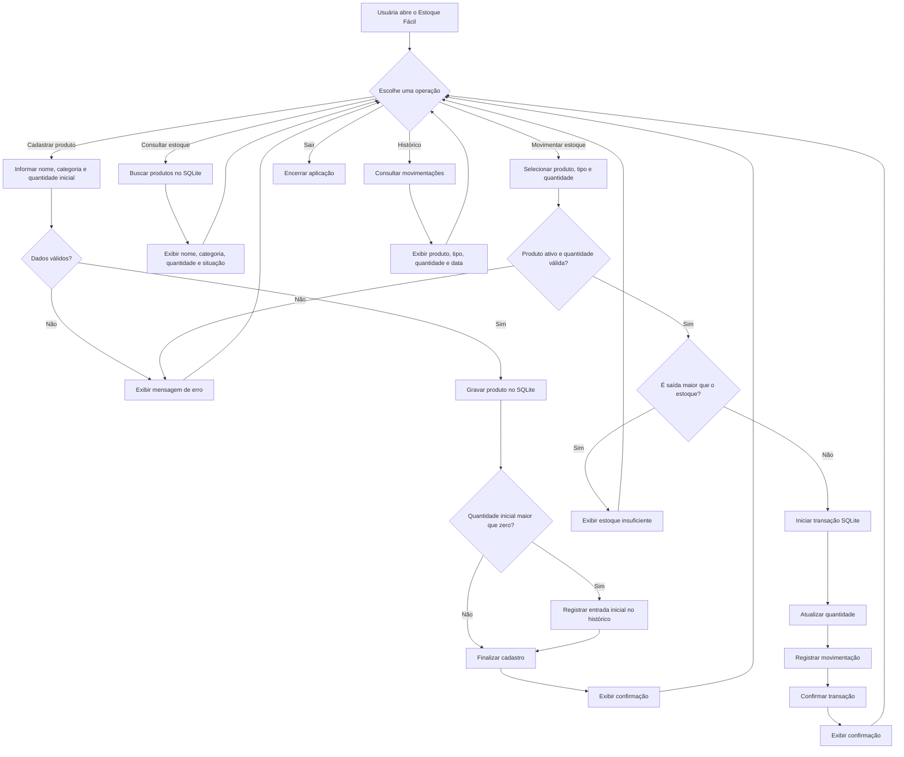

# Fluxograma — Estoque Fácil



## Fluxo resumido

```text
Usuária → Interface Tkinter → Regras de negócio → SQLite
                                      ↓
                              Validação e transação
                                      ↓
                               Mensagem de retorno
```
